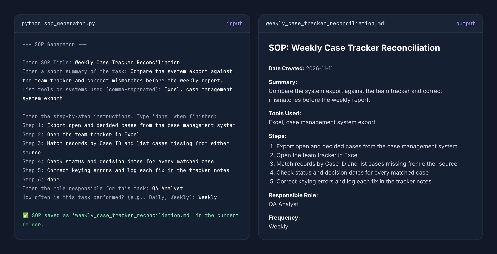

# 🧰 SOP Generator

Python tool for writing SOPs in a consistent format from a short set of prompts. Built for teams who fix a process and need the new steps written down the same way every time, so training and handoffs don't depend on who wrote the document.

The script asks for a title, summary, tools, steps, responsible role, and frequency, won't save until every field is filled in, and writes the result as a numbered, dated Markdown file.

## 🔍 What It Does

- Prompts for SOP title, summary, tools, step-by-step instructions, responsible role, and frequency
- Requires every field, including at least one step, so SOPs aren't saved incomplete
- Numbers steps automatically and adds a creation date
- Saves each SOP as a Markdown `.md` file named after its title, without overwriting existing SOPs

## 📊 Sample Output

The script prompts for each field, then saves a formatted SOP named after its title.

## 📘 Use Case and SIPOC

See [`USE_CASE_AND_SIPOC.md`](USE_CASE_AND_SIPOC.md) for the use case (main flow, exception flows, and business rules) and a SIPOC showing suppliers, inputs, process steps, outputs, and customers for the SOP process.

## 🧰 Tools Used

- Python 3 (AI-assisted development)
- Standard library (`datetime`, `os`, `re`)

## 📁 File Overview

- `sop_generator.py` - Script that captures inputs and generates formatted SOP documents
- [`examples/weekly_case_tracker_reconciliation.md`](examples/weekly_case_tracker_reconciliation.md) - Sample SOP created by the script
- `images/sop_example.png` - Screenshot of the prompts and the generated SOP
- `USE_CASE_AND_SIPOC.md` - Use case with main and exception flows, business rules, and SIPOC

## ▶ How to Use It

1. Run `python sop_generator.py`
2. Enter workflow details when prompted (type `done` to finish entering steps)
3. The SOP is saved as a Markdown file in the working directory

## 📌 Purpose

Built from process improvement work, where a fixed workflow only stays fixed once the new steps are written down and followed the same way by everyone. The [sample SOP](examples/weekly_case_tracker_reconciliation.md) covers a weekly case tracker reconciliation.