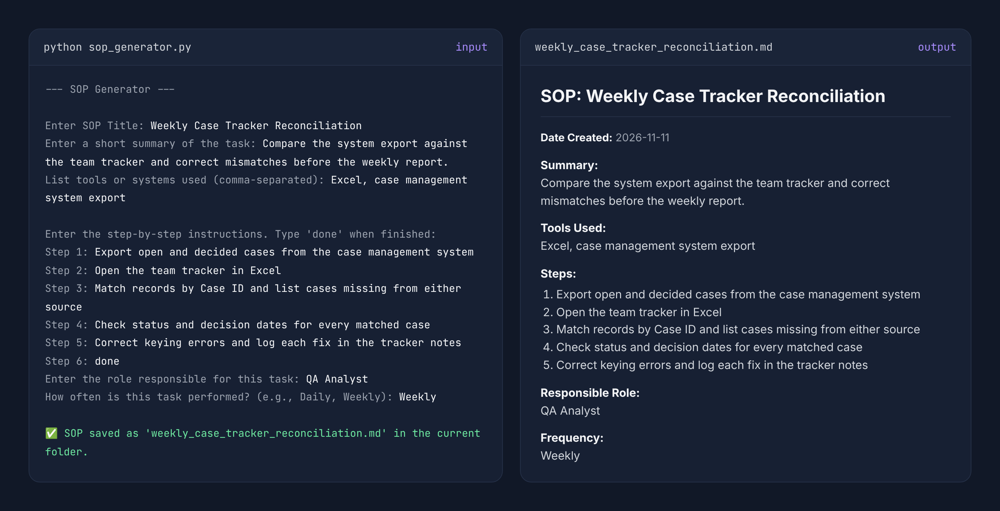

# 🧰 SOP Generator

Python-based tool for generating structured Standard Operating Procedures (SOPs) from user input. Designed to support consistent documentation of repeatable workflows across operational and team environments.

Outputs formatted SOP documents in Markdown for use in training, process documentation, and workflow standardization.

## 🔍 What It Does

- Prompts for SOP title, summary, tools, step-by-step instructions, responsible role, and frequency
- Requires every field, including at least one step, so SOPs aren't saved incomplete
- Numbers steps automatically and adds a creation date
- Saves each SOP as a Markdown `.md` file named after its title, without overwriting existing SOPs

## 📊 Sample Output

The script prompts for each field, then saves a formatted SOP named after its title.

## 🧰 Tools Used

- Python 3 (AI-assisted development)
- Standard library (`datetime`, `os`, `re`)

## 📁 File Overview

- `sop_generator.py` - Script that captures inputs and generates formatted SOP documents
- `examples/weekly_case_tracker_reconciliation.md` - Sample SOP created by the script
- `images/sop_example.png` - Screenshot of the prompts and the generated SOP

## ▶ How to Use It

1. 1. Run `python sop_generator.py`
2. Enter workflow details when prompted (type `done` to finish entering steps)
3. The SOP is saved as a Markdown file in the working directory

## 📌 Purpose

Supports structured documentation workflows by standardizing SOP creation for operational processes, training materials, and repeatable task definitions. Focuses on consistency, clarity, and reducing variation in how workflows are documented.
